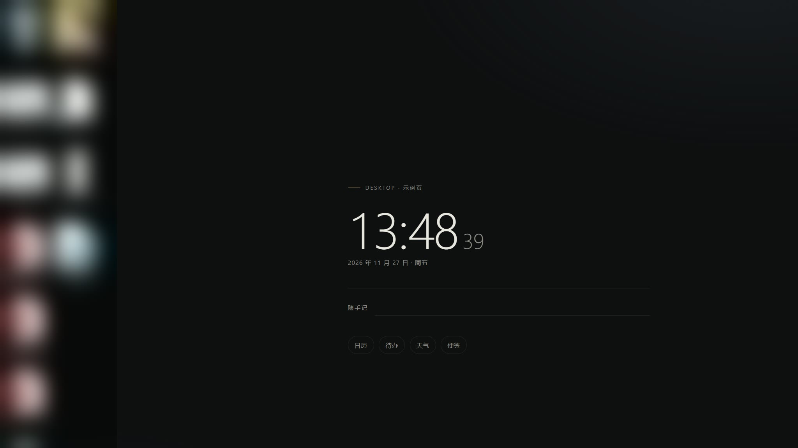
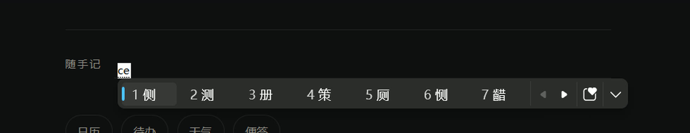

# 网页壁纸 · WebWallpaper

把任意网址铺成 Windows 桌面壁纸：网页在桌面图标下面，图标照常点、照常拖；网页里的按钮、滚动、输入框也都能用。



## 它解决什么

Windows 自带壁纸只能是图片或幻灯片。想让桌面显示一个网页看板（自建的首页、监控面板、待办、日历），过去只能开一个全屏窗口，挡住图标、抢走任务栏。

这个程序把网页塞进桌面那一层：图标在上面，网页在下面。不写系统壁纸设置，不改资源管理器进程，退出就恢复原壁纸，也不需要管理员权限。

## 效果

| 整体 | 输入 |
| --- | --- |
| 网页铺满桌面工作区，图标照常可用 | 点输入框就能打拼音，候选框贴着光标 |



## 功能

- **贴在桌面层**：窗口挂进系统的桌面容器，比壁纸高、比图标低；任务栏换边、改高度、换显示器后自动重新贴合。
- **鼠标可用**：点击、拖拽、滚轮都转给网页；桌面图标、任务栏、右键菜单照旧归 Windows。
- **键盘和输入法可用**：点网页上的输入框就能打字，拼音直接出现在你点的那个框里，候选框跟着光标走；换行、换输入框、光标移动，候选框都会跟上。
- **组合键转发**：`Ctrl+A/C/X/V/Z`、`Ctrl+方向键`、`Ctrl+Backspace`、`Shift+Tab`、`Shift+方向键`、`Shift+Home/End`、`Enter`、`Shift+Enter`、`F5` / `Ctrl+R`。
- **`Win` 和 `Alt` 组合永远留给系统**：`Win+D`、`Alt+Tab`、`Alt+F4` 随时能用。
- **多屏独立配置**：每块屏可以放不同网址、单独缩放，或者干脆不铺。
- **托盘控制**：重新加载配置、打开配置文件、结束编辑、开机自启、退出并恢复原壁纸。
- **连不上不烦人**：网页打不开时显示一张安静的等待页，每 8 秒自动重试，服务起来就自动显示。
- **只碰公开的窗口层级**：不写系统壁纸设置，不往别的进程写内存。

## 运行要求

- Windows 10 / 11（64 位）
- [.NET 8 桌面运行时](https://dotnet.microsoft.com/download/dotnet/8.0)
- [Microsoft Edge WebView2 运行时](https://developer.microsoft.com/microsoft-edge/webview2/)（Windows 11 已内置）

## 编译与运行

```powershell
git clone https://github.com/iranolly/web-wallpaper.git
cd web-wallpaper
dotnet publish src/WebWallpaper.csproj -c Release -r win-x64 --self-contained false -o dist
.\dist\WebWallpaper.exe
```

也可以直接用 Visual Studio 打开根目录的 `WebWallpaper.sln`。

首次运行会在程序目录生成 `config.json`，默认网址是本机 `http://127.0.0.1:18787/`，改掉它就能显示你的页面；托盘菜单里点「重新加载配置」立刻生效，不用重启。

想先看效果，不用准备网站：`demo/index.html` 是一张自带的演示页，单文件、断网也能开。把 `DefaultUrl` 改成指向它的 `file://` 地址（例如 `file:///D:/web-wallpaper/demo/index.html`）再启动即可。

## 配置

```json
{
  "DefaultUrl": "https://example.com/",
  "RightClickDesktopMenu": true,
  "WheelScroll": true,
  "ImeShiftToggle": true,
  "KeyboardHook": true,
  "NativeFocus": true,
  "LiftWindow": true,
  "Screens": [
    { "Monitor": "\\\\.\\DISPLAY1", "Url": "", "Enabled": true, "Zoom": 1.0 },
    { "Monitor": "\\\\.\\DISPLAY2", "Url": "https://example.com/charts", "Enabled": true, "Zoom": 1.0 }
  ]
}
```

| 字段 | 默认 | 作用 |
| --- | --- | --- |
| `DefaultUrl` | 本机示例地址 | 没单独指定网址的屏幕都用它 |
| `RightClickDesktopMenu` | `true` | 桌面右键仍然弹出 Windows 菜单 |
| `WheelScroll` | `true` | 滚轮转给网页；关掉就交回系统 |
| `ImeShiftToggle` | `true` | 打字时按一下 `Shift` 切换输入法中／英文 |
| `KeyboardHook` | `true` | 安装全局键盘监听以转发组合键；关掉只保留少量固定按键 |
| `NativeFocus` | `true` | 编辑时把网页升成真窗口，让输入法直接作用在网页上 |
| `LiftWindow` | `true` | 进入编辑时把网页升到图标上面；关掉则只抢焦点、不改变层级 |
| `Screens[].Monitor` | — | 显示器设备名，和显示设置里一致 |
| `Screens[].Url` | 空 | 留空就用 `DefaultUrl` |
| `Screens[].Enabled` | `true` | `false` 表示这块屏不铺网页 |
| `Screens[].Zoom` | `1.0` | 网页缩放，`1.0` 与浏览器默认一致 |

文件放在程序目录，改完点托盘「重新加载配置」。

## 键盘一览

| 按键 | 行为 |
| --- | --- |
| 点网页再打字 | 键盘进入网页，`Esc` 结束编辑 |
| `Enter` / `Shift+Enter` | 交给网页自己判断（发送或换行） |
| `F5` / `Ctrl+R` | 重新载入当前网页 |
| `Shift`（松开） | 切换输入法中／英文 |
| `Ctrl+Space`、`Ctrl+Shift` | 不放给网页，属于系统输入法切换 |
| `Win+*`、`Alt+*` | 一律留给系统 |

## 已知限制

- 拼音还没上屏时点别处，这段拼音会丢。新式输入法不接受外部程序替它"提交"，只认焦点离开；先按空格再点走就不会遇到。
- 网页拖拽（滑块、地图）在壁纸模式下不够稳：按下、移动、松开是分段转发的，快速拖动会丢帧。
- 输入框如果嵌在**跨域**的框架里，候选框只能落在那个框架的范围内（浏览器不允许程序进去读光标）；同源框架、普通页面都正常。
- 网页弹出的选择框、文件框不会浮到桌面上层，这类操作先在浏览器里完成。
- 编辑期间桌面图标会被网页盖住，点不到；按 `Esc` 或点任务栏即可恢复。
- `Win+D` 回桌面再回来，要重新点一次网页才能继续打字。
- 以管理员身份运行的窗口在前台时收不到按键（系统隔离）；关掉那个窗口即可。
- `Ctrl+Alt+Del`、`Win+L`、`Ctrl+Shift+Esc` 属系统保留键，任何程序都拦不住——也正因如此你总能脱身。
- 全屏游戏或演示时网页仍在后台运行，暂不自动暂停。

## 实现思路

1. **贴桌面**：把窗口设为系统桌面容器（`Progman`）的子窗口，插到图标视图下面，于是它比壁纸高、比图标低。
2. **接管鼠标**：装一个低级鼠标钩子，只在鼠标落在桌面空白处时，把点击、拖拽、滚轮按坐标投给网页。
3. **接管键盘**：装一个低级键盘钩子判断每个键该给谁，`Win`／`Alt` 组合与系统保留键立即放行；回调里只做判断和投递，不写日志、不碰网页。
4. **输入法**：在光标位置放一个看不见的真文本框（或用真窗口焦点），输入法对这个目标工作，组好的字再交给网页——候选框因此能贴着光标走。
5. **兜底**：定时看护窗口层级和屏幕变化，网页加载失败进等待页，离开网页立刻卸掉钩子、把键盘还给系统。

## 目录

```
src/            全部程序源码（C# / WinForms / WebView2）
demo/           演示页，单文件、无外部依赖，断网也能打开
docs/           截图
WebWallpaper.sln
```

## 许可

[MIT](LICENSE)
